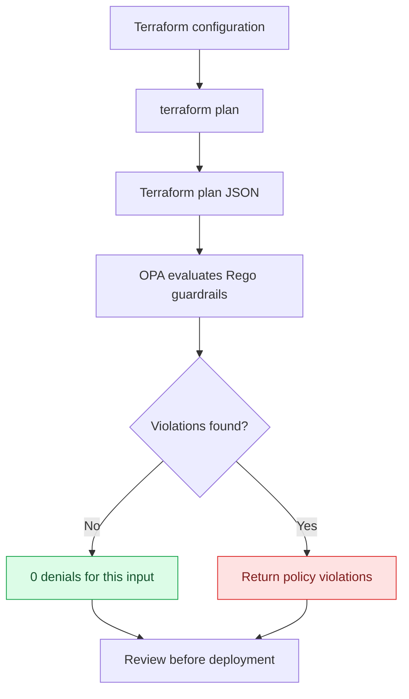

<!--
  Zero Trust Infrastructure Guardrails
  Interactive README: GitHub-native Markdown, collapsible details, and Mermaid.
-->

<div align="center">

# 🛡️ Zero Trust Infrastructure Guardrails

### Terraform plan security checks powered by OPA / Rego

**Catch selected cloud misconfigurations before deployment — with policy tests, reproducible fixtures, and explicit handling of uncertain plan data.**

<p>
  <a href="https://github.com/hak3du/zero-trust-policy-as-code"></a>
  <a href="https://developer.hashicorp.com/terraform"></a>
  <a href="https://github.com/hak3du/zero-trust-policy-as-code/tree/main/policy"></a>
  
</p>

[Explore the policies](./policy/guardrails.rego) · [Inspect the tests](./policy/guardrails_test.rego) · [Read the evidence log](./PRO_NOTES.md)

</div>

---

> [!IMPORTANT]
> **This is a portfolio demonstrator, not a production security product.** The rules cover selected AWS resource patterns; they do not establish complete NIST SP 800-207 conformance. Validate policies against your Terraform/AWS provider versions and organizational requirements before relying on them.

## ✨ At a glance

<table>
  <tr>
    <td align="center" width="33%">
      <h2>14 / 14</h2>
      <strong>Local Rego tests passed</strong><br>
      <sub>Observed local test run</sub>
    </td>
    <td align="center" width="33%">
      <h2>0</h2>
      <strong>Compliant-fixture denials</strong><br>
      <sub>Expected allow-path result</sub>
    </td>
    <td align="center" width="33%">
      <h2>4</h2>
      <strong>Noncompliant-fixture denials</strong><br>
      <sub>Expected deny-path result</sub>
    </td>
  </tr>
</table>

<sub>These figures describe local validation evidence, not a hosted CI pass, production deployment, or a guarantee that every misconfiguration is detected.</sub>

## 🧭 Navigate the project

- [What it checks](#-what-it-checks)
- [How the gate works](#-how-the-gate-works)
- [The edge case that matters](#-the-edge-case-that-matters)
- [Run it locally](#-run-it-locally)
- [Explore the evidence](#-explore-the-evidence)
- [Limitations and roadmap](#-limitations-and-roadmap)

## 🔍 What it checks

| Control area | Detection intent |
|---|---|
| 🌐 Public SSH | Deny public IPv4/IPv6 ingress to TCP port 22 |
| 🖥️ Public RDP | Deny public IPv4/IPv6 ingress to TCP port 3389 |
| 💽 EBS encryption | Deny EBS volumes explicitly configured without encryption |
| 🪣 S3 public access | Deny selected S3 public-access-block settings when explicitly disabled |
| ❓ Unknown ingress | Do not automatically treat explicitly configured, unresolved ingress as safe |

<details>
  <summary><strong>See the exact test cases</strong></summary>

  The current test suite includes coverage for:

  - Public SSH and RDP over IPv4
  - Public SSH and RDP over IPv6
  - Unencrypted EBS volume configuration
  - Each of the four S3 public-access-block settings
  - Delete-only changes being ignored
  - Unknown security-group ingress, including omitted versus explicitly configured ingress

  Open the [test source](./policy/guardrails_test.rego) for the executable assertions.
</details>

## ⚙️ How the gate works



The policy evaluates planned changes and returns human-readable violations. It is designed to make selected security decisions testable before infrastructure is applied; it does **not** deploy, remediate, or modify AWS resources.

## 🧠 The edge case that matters

Terraform plans can mark a resource attribute as unknown until apply. In the observed AWS provider checks, `after_unknown.ingress` could be true even when the security-group configuration omitted an ingress block.

A policy that treats every unknown ingress value as equivalent can produce a misleading result. This project adds a targeted distinction:

- **Ingress omitted in configuration:** the observed test case returns no violation.
- **Ingress explicitly configured but unresolved:** the observed test case is denied rather than assumed safe.

<details>
  <summary><strong>Evidence and boundaries</strong></summary>

  - The observed local provider checks used Terraform-generated plan JSON and AWS provider v6.70.0.
  - Public SSH and RDP test configurations produced denials.
  - The checks used dummy credentials and test configuration.
  - No AWS infrastructure was applied or changed.
  - Nested child-module traversal and all nested/partial unknown-value cases are not yet fully validated.

  This is a **targeted mitigation with regression tests**, not a claim that every unknown-value scenario is solved. See [PRO_NOTES.md](./PRO_NOTES.md) for the evidence ledger and commands.
</details>

## 🚀 Run it locally

### Requirements

- [OPA CLI 1.x](https://www.openpolicyagent.org/docs/latest/#running-opa)
- Bash, Make, WSL, or Git Bash for the shell checks
- On Windows, PowerShell can run the included validation script

<details open>
  <summary><strong>Option A — PowerShell (Windows)</strong></summary>

  ```powershell
  opa version
  .\validate.ps1
  ```

  The script runs the Rego tests and checks both example fixtures.
</details>

<details>
  <summary><strong>Option B — Bash / WSL / Git Bash</strong></summary>

  ```bash
  opa version
  opa test policy -v
  bash scripts/check.sh
  ```
</details>

### Evaluate a plan you generated

Run only in a test environment and inspect the plan for sensitive information before sharing it.

```bash
terraform plan -out=tfplan
terraform show -json tfplan > tfplan.json
opa eval --format pretty \
  --data policy \
  --input tfplan.json \
  'data.terraform.guardrails.violations'
```

A compliant fixture should return zero violations; the noncompliant fixture should return one or more. The exact result depends on the input plan and the current policy.

## 🧪 Explore the evidence

| Artifact | What you can verify |
|---|---|
| [Policy](./policy/guardrails.rego) | The actual deny rules and planned-change handling |
| [Regression tests](./policy/guardrails_test.rego) | Expected behavior for the selected edge cases |
| [Compliant fixture](./examples/compliant-plan.json) | A sample input expected to produce zero denials |
| [Noncompliant fixture](./examples/noncompliant-plan.json) | A sample input expected to produce four denials in the observed check |
| [Validation script](./validate.ps1) | The local Windows validation path |
| [Evidence notes](./PRO_NOTES.md) | Commands run, observed results, and known limitations |
| [GitHub Actions workflow](./.github/workflows/zero-trust-policy.yml) | The hosted validation workflow definition |

<details>
  <summary><strong>Current verification status</strong></summary>

  **Locally observed:** 14/14 Rego tests passed; compliant fixture produced 0 denials; noncompliant fixture produced 4 denials.

  **Hosted CI:** Not confirmed green. GitHub Actions runner startup has previously been blocked by an account billing restriction. A local pass must not be represented as a successful hosted workflow run.

  **Cloud deployment:** None performed for these checks.
</details>

## 🧱 Limitations and roadmap

- [ ] Validate unknown-value handling for nested modules and partial unknowns.
- [ ] Add provider-version regression coverage for additional Terraform plan shapes.
- [ ] Obtain a successful hosted CI run once the runner billing restriction is resolved.
- [ ] Expand controls only alongside tests and documented expected behavior.
- [ ] Validate policy decisions against the versions and standards used by a real target environment.

## 💼 Resume-ready summary

> Built a Terraform plan policy gate with OPA/Rego to detect selected cloud misconfigurations before deployment, supported by positive/negative fixtures and automated policy tests.

Describe measured impact only when you have evidence for it. This repository demonstrates a focused policy-engineering prototype; it is not evidence of a production rollout or complete cloud-security coverage.

---

<div align="center">

**Policy as code. Decisions you can test.**

<sub>Built for learning, review, and reproducible security engineering.</sub>

</div>
